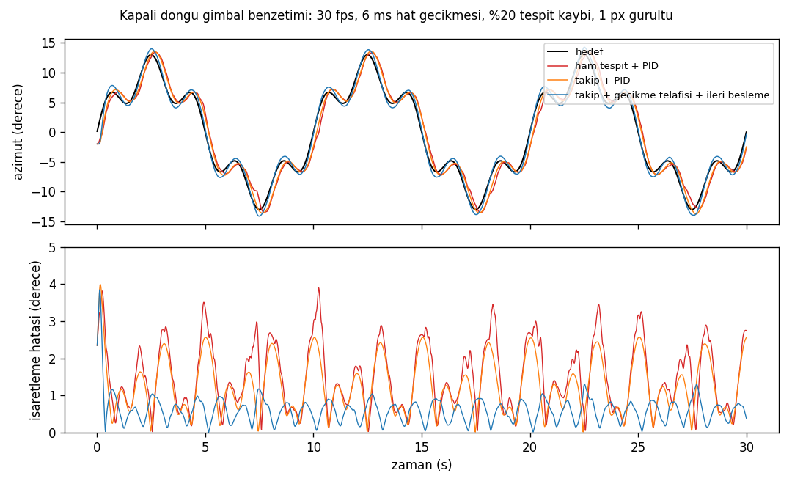

# iha-takip

[](https://github.com/l4NGEL/iha-takip/actions/workflows/ci.yml)

Termal (IR) kamerada küçük İHA'ları tespit edip takip eden ve hedefin konumunu gimbal için
açı hatasına çeviren uçtan uca görüntü işleme hattı.

```
 kamera / dosya / RTSP / GStreamer
        │
        ▼
 yakalama ─▶ CUDA ön işleme ─▶ TensorRT (YOLO26, FP16) ─▶ ByteTrack + Kalman ─▶ hedef kilidi
 (ayrı iş     (letterbox,        (uçtan uca, NMS'siz)       (DIoU maliyeti,          │
  parçacığı,   BGR→RGB, CHW,                                 iki aşamalı eşleşme,     ▼
  en son kare) tek kernel)                                   kamera hareketi    piksel → azimut/elevasyon
                                                             telafisi)          (+ gecikme telafisi)
                                                                                      │
                                                                                      ▼
                                                                     UDP, 38 baytlık CRC'li mesaj
                                                                                      │
                                                                                      ▼
                                                                     gimbal (benzetim: PID + 2 eksen)
```

- **Model eğitimi (Python):** YOLO26, [Anti-UAV410](https://github.com/HwangBo94/Anti-UAV410) termal
  videolarında eğitildi ve resmi train/val/test bölümüyle değerlendirildi.
- **Çalışma zamanı hattı (C++17):** Python içermez. CUDA ön işleme, TensorRT, takip, açı hatası, UDP ve
  aşama aşama gecikme ölçümü bu katmanda.
- **Çekirdek kütüphane:** Takip, açı hatası, PID, protokol, UDP ve optik akışla kamera hareketi kestirimi
  GPU olmadan derlenir. CI'da `-Werror`, ASan ve UBSan ile 57 GoogleTest koşar.

## Sonuçlar

Bütün sayılar, eğitimde ve ayar seçiminde hiç kullanılmamış **120 test dizisinden** gelir
(129.691 kare). Eşikler ve takip ayarları önce val dizilerinde seçildi. Tespit testi bir kez koşuldu; takip testi ilk sürüm ve
kamera telafili sürüm için iki kez koşuldu.
Kaynak dosyalar `results/` altında.

### Tespit (YOLO26s-P2, eşik val'de seçildi: 0.415)

| Hedef boyutu (√alan) | Kare | AP50 | Precision | Recall |
|---|---|---|---|---|
| Hepsi | 127.028 | **0.857** | 0.943 | 0.796 |
| < 16 px | 36.986 | **0.700** | 0.853 | 0.604 |
| 16–32 px | 27.127 | 0.888 | 0.964 | 0.844 |
| ≥ 32 px | 62.915 | 0.919 | 0.979 | 0.888 |

- **Yanlış alarm:** Hedefsiz karelerin %6.8'inde var (2.622 kare).
- **Örtülme:** Örtülmüş hedeflerde (OC, 707 kare) AP50 0.01. Model örtülen hedefi neredeyse hiç bulamıyor.
- **P2 başlığı:** Küçük hedefler için ek stride-4 başlığı denendi. Val'de önceden sabitlenen kurala göre
  seçildi, ama fark ne val'de ne testte anlamlı. Testteki fark, dizi düzeyinde bootstrap ile
  −0.001 [−0.008, +0.007]; 16 pikselden küçük hedeflerde −0.002 [−0.037, +0.032].
  Daha ucuz olan standart başlık da aynı işi görürdü (`results/det/`).

### Takip (Anti-UAV durum doğruluğu, SA)

SA, kare başına şöyle hesaplanır:
- **Hedef varsa:** tahmin kutusunun IoU'su.
- **Hedef yoksa:** "yok" denmişse 1, aksi halde 0.

| | Her karede en iyi tespit (takipsiz) | ByteTrack + Kalman | + görüntüden kamera hareketi telafisi |
|---|---|---|---|
| SA (dizi ortalaması) | 0.648 | 0.677 | **0.678** |
| Hedefli karede IoU ≥ 0.5 | 0.794 | 0.842 | 0.844 |
| Küçük hedef (TS) ortalama IoU | 0.536 | 0.616 | 0.617 |
| Hızlı hareket (FM) | 0.425 | 0.486 | 0.486 |
| Karmaşık arka plan (DBC) | 0.450 | 0.543 | 0.543 |
| Hedefsiz karede doğru "yok" | **0.942** | 0.809 | 0.809 |

- **Kazanç:** Son sürüm takipsiz tabana göre +0.030 SA [0.021, 0.040] getiriyor ve 120 dizinin 109'unda daha iyi.
- **Telafinin payı:** Görüntüden kamera hareketi telafisinin katkısı küçük ama tutarlı: +0.0012 [0.0007, 0.0018],
  63 dizide iyi, 27'sinde kötü. Val'de kameranın gerçekten hareket ettiği 21 dizide +0.0021 [0.0009, 0.0036].
  Seçilen ayar öngörüye az dayandığı için (en fazla 5 karelik sürdürme) çıktıyı büyük ölçüde tespit belirliyor.
- **Test kullanımı:** Test kümesi takip için iki kez kullanıldı: ilk sürüm ve telafi eklenmiş son sürüm. Her iki
  seçim de test görülmeden val'de yapıldı.
- **Bedel:** Drone yokken çıktı verme oranı artıyor. `--out-score 0.5` ile hedefsiz karede doğru "yok" oranı
  0.81'den 0.90'a çıkıyor, SA 0.678'den 0.648'e iniyor. SA ölçütü bu kapıyı seçmediği için varsayılan kapalı;
  yanlış alarmın pahalı olduğu bir görevde açılacak bir ayar.
- **Kıyas sınırı:** Anti-UAV410 tablosundaki SOT izleyicileri ilk karede gerçek kutuyla başlatılır. Bu hat hiçbir
  gerçek kutu almadığı için o tablolarla doğrudan karşılaştırılamaz.

### Gecikme (RTX 2080, TensorRT 10.8 FP16, 5 test dizisi, 5.948 kare, aşama başına senkron ölçüm)

| Aşama | p50 (ms) | p99 (ms) |
|---|---|---|
| Yükleme (sabitlenmiş bellek → GPU) | 0.29 | 0.60 |
| CUDA ön işleme | 0.11 | 0.45 |
| TensorRT çıkarım | 3.54 | 5.82 |
| Son işleme | 0.10 | 0.24 |
| Takip | 0.01 | 0.03 |
| Açı hatası + UDP | < 0.01 | < 0.01 |
| **Uçtan uca (görüntüden mesaja)** | **4.08** | **6.57** |

- **JPEG okuma:** Diskten okuma ve çözme bu tabloya dahil değil; ayrıca ölçüldü, p50 1.2 ms.
- **Canlı akış:** GStreamer ile 30 fps beslenen bir dizi (994 kare) uçtan uca p50 8.7 ms, p99 18.5 ms verdi.
  Çıkarım bu kipte veri kümesi kipinin iki katı (p50 7.4 ms). Kareler arasında GPU'nun saat hızını düşürmesi
  olası bir neden; doğrulanmadı.
- **Kayıp:** 30 fps akışta 5 kare atıldı. UDP alıcısı 994 mesajın hepsini CRC'den geçirdi, sıra numarasında
  boşluk yok (`scripts/udp_listen.py`).
- **Görüntüden kamera telafisinin bedeli (`--cmc`):** Optik akış CPU'da yarım çözünürlükte kare başına p50 4.3 ms,
  p99 19 ms sürüyor. Çıkarımla eşzamanlı ayrı iş parçacığında koşsa da CPU'yu paylaştığı için hattı yavaşlatıyor.
  Masaüstü yükü altında, dönüşümlü 3+3 koşuda uçtan uca p50 ~10.9 ms'den ~16.1 ms'ye, p99 ~31 ms'den ~49 ms'ye
  çıktı (`results/latency_ab_*.json`). SA'ya katkısı +0.001 olduğu için canlı hatta varsayılan olarak kapalı;
  gimbal enkoderi varsa telafi oradan hesapsız gelir.

### Doğruluk kontrolleri

- **CUDA ön işleme:** Ultralytics `LetterBox` + numpy referansıyla **bit düzeyinde aynı**; en büyük fark 0.0.
- **TensorRT FP16 ile ONNX Runtime FP32 (200 kare):** En iyi kutunun IoU'su ortalama 0.988, en kötü 0.968.
  Skor farkı en fazla 0.0045. Eşik kararı 200 karenin hepsinde aynı.

### INT8: denendi, kullanılmadı

Entropi kalibrasyonu yalnız train dizilerinden 500 kareyle yapıldı. Val sonuçları:

| | FP16 | INT8 |
|---|---|---|
| AP50 | 0.868 | 0.842 |
| Recall (eşik 0.415) | 0.836 | 0.486 |
| < 16 px recall | 0.519 | 0.005 |
| Takip SA | 0.726 | 0.638 |
| Uçtan uca p50, dönüşümlü 2+2 koşu, masaüstü yükü altında | 10.9 ms | 10.1 ms |

- **Neden:** Doğru tespitlerin medyan skoru 0.82'den 0.43'e iniyor. Eşiği INT8 için val'de yeniden seçmek de
  F1'i 0.896'dan 0.854'e kadar düşürüyor.
- **Karar:** Bu GPU'da %8–12'lik hız kazancı (boşta ve yük altında) bu doğruluk kaybına değmiyor.
- **Denenmeyenler:** P2 başlığını FP16'da bırakan karışık hassasiyet ve nicemlemeye duyarlı eğitim (QAT).

### Gimbal kapalı döngü (benzetim)

Benzetim modeli:
- 30 fps kamera.
- Tespitlerin %20'si kayboluyor (test recall'u 0.80), 1 piksellik gürültü.
- Hız ve ivme sınırlı iki eksenli gimbal.
- Hedef 16°/sn'ye kadar manevra yapıyor.

Her değer 20 rastgele tohumun ortalaması (`cpp/apps/gimbal_sim.cpp`).

| Denetleyici | 6 ms (ölçülen) | 33 ms | 66 ms |
|---|---|---|---|
| Ham tespit + PID | 1.75° | 1.83° | 1.93° |
| Takip + PID | 1.45° | 1.51° | 1.59° |
| Takip + gecikme telafisi + hedef hızı ileri besleme | **0.70°** | 0.87° | 1.13° |
| Takip, yapışkan kilit, kamera hareketi telafisi yok | 31.1° (hedef kaybediliyor) | 29.4° | 26.0° |

Tablodaki değerler RMS işaretleme hatası.



## Yol boyunca bulunanlar

- **Yapışkan hedef kilidi takibi bozuyordu.** İlk tasarımda kilitli takip, eşleşmesiz kaldığında da birkaç kare
  öngörüyle sürdürülüyordu. Val'de bu, takipsiz tabandan bile kötüydü: 30 karelik sürdürmede SA 0.50, taban 0.71.
  Kilit bir parazite takılınca gerçek hedef o süre boyunca kaçırılıyordu. Kilit, aynı karede ölçülmüş başka bir
  onaylı takip varsa ona yol verecek şekilde değiştirildi; aynı ayarda SA 0.72'ye çıktı. Gimbal benzetimindeki
  ıraksamanın kaynağı da buydu.
- **Kamera hareketi telafisinin etkisi küçük çıktı.** Benzetimde enkoderden gelen telafiyle takipçi, telafisiz
  takipçiyle aynı düzeyde (1.45° ve 1.43°). Telafinin oradaki asıl işlevi, "gecikme telafisi + ileri besleme"
  denetleyicisinin kullandığı Kalman hızını hedefin dünya açısal hızına çevirmek. Gerçek dizilerde görüntüden
  kestirilen telafi SA'ya +0.001 ekliyor. Val dizilerinin çoğunda kamera sabit (kare arası medyan öteleme
  0.01 px); 21 dizide ise kare başına 28 piksele varan pan var.
- **Hızlı ve küçük hedefte yeni takip hiç onaylanmıyordu.** Yeni takibin hız belirsizliği boyuta oranla
  başlatıldığında 6 piksellik, karede 10 piksel giden bir hedefin ikinci karedeki tespiti kapı dışında kalıyordu.
  Başlangıç hız sapması ayrı bir parametre oldu (10 px/kare) ve birim testiyle kilitlendi.
- **Girdi çözünürlüğünü büyütmek küçük hedefe yaramadı.** 640'ta eğitilen model 800 ve 960'ta çalıştırıldı.
  Val'de 16 pikselden küçük hedeflerde AP50 0.573 / 0.575 / 0.572; 960'ta yanlış alarm %2.9'dan %9.1'e çıktı.
  Sınır çözünürlükten gelmiyor gibi. Sonraki deneme zamansal bilgi olmalı: kare farkı ya da çok kareli girdi
  ile yeniden eğitim.
- **OpenCV iş parçacıkları GPU hattıyla çekişiyordu.** Telafi açıkken OpenCV'nin varsayılan havuzu bütün
  çekirdekleri kullanıyor ve çıkarım gecikmesini uzatıyordu. Canlı hatta OpenCV tek iş parçacığına sınırlandı
  (`--cv-threads`); CUDA'nın bloklayan senkronu (`--blocking-sync`) bu makinede daha kötü sonuç verdi.
- **Takip ayarı:** Val'de en iyi sonuç `min_hits` = 1'de çıktı (onay beklemek SA'yı düşürdü). Takipsiz tabana
  göre kazancın büyük kısmı, düşük skorlu tespitlerin ikinci aşamada eşleşmesinden geliyor.

## Sınırlar

- **Donanım:** Jetson'da çalıştırılmadı; bütün gecikme sayıları RTX 2080 (Turing) üzerinden. CMake Orin için
  `sm_87` derler, ama orada ölçüm yok.
- **Gimbal:** Gerçek bir gimbal yok; kapalı döngü sayıları benzetimden geliyor. Yaw ve pitch bağımsız kabul edildi.
- **Kamera:** Anti-UAV kamera iç parametrelerini vermiyor. Açı hatası, 30°'lik varsayımsal yatay görüş açısıyla
  hesaplanıyor (`--hfov`); gerçek sistemde kalibrasyon sonucu kullanılmalı.
- **Kamera hareketi telafisi:** İki kaynak var. Gimbal enkoderi benzetimde, görüntüden optik akışla kestirim
  (`iha_vision`, LK + RANSAC benzerlik dönüşümü) gerçek dizilerde kullanılıyor. Kestirim val karelerinin %99.5'inde
  geçerli. Bu dönüşüm stabilizasyonun temeli, ama stabilize video çıktısı üretilmiyor.
- **Gecikme ölçümleri:** Gecikme sayıları masaüstü yüküne duyarlı. Boşta alınan tablo ile yük altındaki
  dönüşümlü A/B koşuları ayrı ayrı raporlanıyor.
- **Akış kipindeki fark:** Zor bir dizide akış kipi (GStreamer `jpegdec`) 1000 karenin 244'ünde, veri kümesi
  kipi (OpenCV `imread`) 320'sinde hedef verdi. JPEG çözücü farkından şüpheleniliyor; doğrulanmadı.
- **Veri lisansı:** Anti-UAV410 CC BY-NC 4.0 lisanslı. Veri bu depoda yok; aşağıdaki komutlarla indirilir.

## Çalıştırma

```bash
# 1) Veri ve eğitim (Python, CUDA'lı PyTorch)
python -m venv --system-site-packages .venv
.venv/Scripts/python scripts/prepare_yolo.py                  # Anti-UAV410 -> YOLO formatı
bash scripts/train_both.sh                                     # YOLO26s ve YOLO26s-P2, 12 epoch
.venv/Scripts/python scripts/eval_detector.py predict --weights runs/yolo26s-p2/weights/best.pt --split val --stride 5 --out results/det/s-p2_val.npz
.venv/Scripts/python scripts/eval_detector.py score --pred results/det/s-p2_val.npz --split val --json results/det/s-p2_val.json

# 2) C++ hat (TensorRT konteyneri)
docker build -t iha-takip:trt -f docker/Dockerfile.trt docker
scripts/docker_trt.sh "cmake -S cpp -B cpp/build-trt -G Ninja && cmake --build cpp/build-trt && ctest --test-dir cpp/build-trt"
scripts/docker_trt.sh "cpp/build-trt/trt_build --onnx checkpoints/yolo26s-p2_antiuav.onnx --out checkpoints/m_fp16.engine --precision fp16"
scripts/docker_trt.sh "cpp/build-trt/iha_track --engine checkpoints/m_fp16.engine --root /data/antiuav410/test --out-dir results/trk/test --udp 127.0.0.1:5600 --high-thr 0.3 --new-thr 0.4 --min-hits 1 --coast 5 --stats results/latency.json"

# GPU'suz çekirdek (CI ile aynı)
cmake -S cpp -B build -DIHA_WITH_TRT=OFF && cmake --build build && ctest --test-dir build
./build/gimbal_sim --seeds 20 --latency-ms 6
```

`iha_track --source` bir video dosyası, RTSP adresi ya da `!` içeren bir GStreamer hattı alır.
`--cmc` görüntüden kamera hareketi telafisini, `--out-score 0.5` yanlış alarmı azaltan çıkış kapısını açar.
Takip ayarını çevrimdışı yeniden kurmak için:

```bash
scripts/docker_trt.sh "cpp/build-trt/motion_dump --root /data/antiuav410/val --out-dir results/trk/motion_val --dets-dir results/trk/dets_val_fp16 --downscale 0.5"
python scripts/tune_tracker.py --dets results/trk/dets_val_fp16 --split val --out results/trk/tune.json --extra "--lock-yield 1 --motion-dir results/trk/motion_val"
```

## Dizin

| Yol | İçerik |
|---|---|
| `src/iha_takip/`, `scripts/` | Veri dönüştürme, eğitim, tespit ve takip değerlendirmesi, bootstrap, parite |
| `cpp/include/iha/`, `cpp/src/` | Çekirdek: Kalman, Macar atama, ByteTrack, açı hatası, PID, gimbal ekseni, protokol, UDP |
| `cpp/trt/` | CUDA letterbox kerneli, TensorRT dedektörü |
| `cpp/src_vision/` | Optik akışla küresel kamera hareketi kestirimi (OpenCV) |
| `cpp/apps/` | `iha_track` (canlı hat), `iha_track_offline`, `motion_dump`, `trt_build` (FP16/INT8), `gimbal_sim` |
| `results/` | Bütün sayıların JSON kaynakları |

## Atıf

```bibtex
@article{huang2023anti,
  title={Anti-UAV410: A Thermal Infrared Benchmark and Customized Scheme for Tracking Drones in the Wild},
  author={Huang, Bo and Li, Jianan and Chen, Junjie and Wang, Gang and Zhao, Jian and Xu, Tingfa},
  journal={IEEE Transactions on Pattern Analysis and Machine Intelligence},
  year={2023}
}
```
